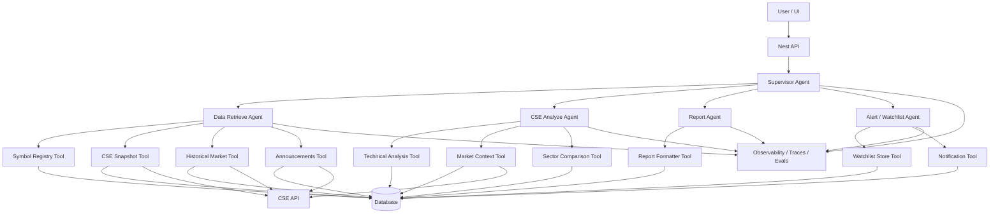

# Stock Analysis AI Architecture

## High-Level Design

## Role Breakdown

### Supervisor Agent
- Receives the user request from the API.
- Decides which specialist agents to run.
- Combines their outputs into one final answer.
- Enforces safety, formatting, and workflow order.

### Data Retrieve Agent
- Pulls symbols, snapshots, history, announcements, and market context.
- Normalizes external CSE data into the app’s internal schema.
- Reads from the database first, then falls back to the live CSE feed when needed.

### CSE Analyze Agent
- Interprets price action, market structure, and recent events.
- Produces research-style signals, risks, and conclusions.
- Uses technical indicators and sector comparison data.

### Report Agent
- Turns structured analysis into a readable summary.
- Produces dashboard cards, table output, and chat-ready text.

### Alert / Watchlist Agent
- Manages watchlists, triggers, and saved preferences.
- Detects meaningful moves or announcement events.

## Shared Tool Layer

Tools should stay separate from agents so they can be reused and tested independently.

- Symbol Registry Tool: syncs and resolves CSE symbols.
- CSE Snapshot Tool: fetches live stock snapshot data.
- Historical Market Tool: loads OHLC and volume history.
- Announcements Tool: fetches company announcements.
- Technical Analysis Tool: calculates moving averages, trend, and momentum.
- Market Context Tool: loads ASPI, S&P SL20, and daily market summary.
- Sector Comparison Tool: compares a stock against its sector.
- Report Formatter Tool: converts structured findings into UI-ready output.
- Watchlist Store Tool: stores user watchlists and preferences.
- Notification Tool: sends alert events when thresholds are met.

## Recommended Flow
1. UI calls the API with a symbol or watchlist request.
2. Supervisor Agent routes the request to the right specialist agents.
3. Data Retrieve Agent loads the required data.
4. CSE Analyze Agent evaluates the stock and market context.
5. Report Agent formats the result.
6. Optional Alert Agent updates watchlists or triggers notifications.
7. API returns a structured response to the UI.

## Repo Mapping

- `apps/api` should host the supervisor entry point and the HTTP routes.
- `packages/tools` should host reusable tools.
- `packages/agents` should host agent definitions and workflows.
- `apps/ui` should stay focused on presentation and user interaction.
